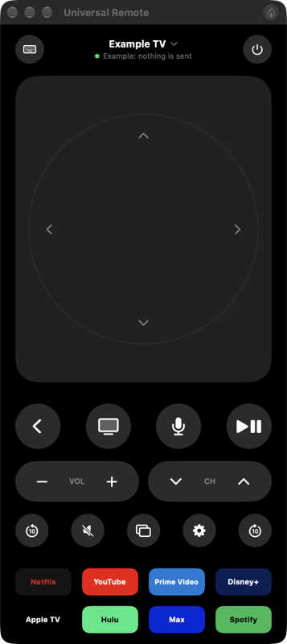

<p align="center"></p>

<h1 align="center">Universal Remote</h1>

<p align="center">One remote you can tap or talk to for your TV, Roku and Sonos speakers.</p>

<p align="center"><a href="#remix-it-with-lamp">Remix it with Lamp</a> · <a href="#build-it-yourself">Build it yourself</a></p>

<p align="center"></p>

## Make Universal Remote yours

It's yours to change by asking Lamp. A few places to start:

- Put the remote on my iPhone
- Add a bedtime button
- A kids' mode with their apps

## Remix it with Lamp

[Lamp](https://lamp.dev) is a Mac app that builds apps from a description and changes them as you ask. In Lamp, choose File → Open from GitHub… and paste `https://github.com/lampdotdev/universalremote`: you get this exact wish, yours to change, with the credits below kept.

## Build it yourself

With Apple's Command Line Tools installed (`xcode-select --install`):

```bash
./build.sh
```

The AI inside the app, and anything it does with other apps or devices, goes through Lamp, so those need Lamp open on the same Mac.

## License

MIT. See [LICENSE](LICENSE).
