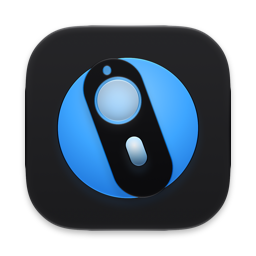
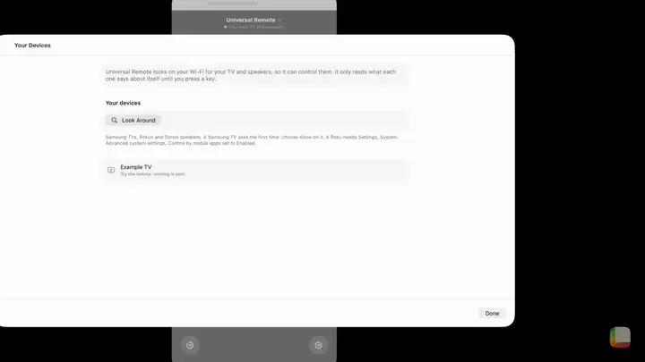

<p align="center"></p>

<h1 align="center">Universal Remote</h1>

<p align="center">One remote you can tap or talk to for your TV, Roku and Sonos speakers.</p>

<p align="center"><a href="https://lamp.dev/?repo=https://github.com/lampdotdev/universalremote&amp;from=readme"></a></p>

<p align="center"><a href="#build-it-yourself">Build it yourself</a></p>

<p align="center"><a href=".github/showcase/reel.mp4"></a></p>

<p align="center"><a href=".github/showcase/reel.mp4">Watch it with sound</a></p>

## Make Universal Remote yours

Each opens Lamp with a copy of Universal Remote and that change, ready to send:

- [Put the remote on my iPhone](https://lamp.dev/?repo=https://github.com/lampdotdev/universalremote&from=readme&ask=Put%20the%20remote%20on%20my%20iPhone)
- [Add a bedtime button](https://lamp.dev/?repo=https://github.com/lampdotdev/universalremote&from=readme&ask=Add%20a%20bedtime%20button)
- [A kids' mode with their apps](https://lamp.dev/?repo=https://github.com/lampdotdev/universalremote&from=readme&ask=A%20kids'%20mode%20with%20their%20apps)

## Open it in Lamp

[Lamp](https://lamp.dev) is a Mac app that builds apps from a description and changes them as you ask. [Open Universal Remote in Lamp](https://lamp.dev/?repo=https://github.com/lampdotdev/universalremote&from=readme) for a copy of your own, to use and to change as you like, with the credits below kept. Or, in Lamp, choose File → Open from GitHub… and paste `https://github.com/lampdotdev/universalremote`.

## Build it yourself

With Apple's Command Line Tools installed (`xcode-select --install`):

```sh
zsh build.sh
```

The AI inside the app, and anything it does with other apps or devices, goes through Lamp, so those need Lamp open on the same Mac.

## License

MIT. See [LICENSE](LICENSE).
